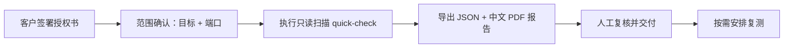

# AI Shield Quick Check — Ollama 安全评估（交付包）

本目录是「AI Shield Quick Check」商业交付包：一个面向本地 Ollama 部署的
快速、只读、人工辅助的安全评估服务，单次授权评估定价 **¥99 / 次**
（英文站固定展示 $15.00 / assessment，不按实时汇率换算）。

## 交付物清单

| 文件 | 用途 |
| --- | --- |
| `服务说明.md` | 一页纸服务说明（给客户看） |
| `客户授权书模板.md` | 评估前必须签署的书面授权 |
| `范围确认模板.md` | 目标、端口与允许动作的书面范围 |
| `报价单模板.md` | ¥99 / 次 的报价模板 |
| `samples/sample_report.pdf` | 本地隔离测试环境生成的示例报告 |
| `samples/sample_report.json` | 同一评估的原始 JSON（保持原格式） |

## 评估流程



## 使用方式

```bash
# 单个已授权目标（默认端口 11434）
python3 ai-shield.py quick-check 127.0.0.1 \
  --customer "示例客户有限公司" \
  --engagement-id QC-2026-0001 \
  --authorized-scope "127.0.0.1:11434 已签署授权书" \
  -o report.pdf

# 自定义端口（例如 Docker 端口映射）
python3 ai-shield.py quick-check 10.0.0.8 --ports 18080 \
  --customer "客户A" --engagement-id QC-2026-0002 \
  --allow-private -o report.json
```

## 检查项（全部只读）

Quick Check 仅执行以下检查，不向模型发送生成请求：

- 网络暴露（是否绑定公网/所有接口）
- 认证缺失（未认证即可读取模型列表）
- CORS 配置（是否允许任意来源）
- 模型访问（未授权列出模型）
- 资源滥用（是否观测到速率限制）
- 已知漏洞（CVE 情报匹配，版本已知时）

有意排除：提示词注入、数据泄露（这两项需要让客户模型生成内容，
不符合快速只读评估定位；报告中会明确该局限）。

## 安全边界（默认拒绝）

- 默认只允许回环地址；私网/公网目标需要显式 `--allow-private` 或
  `AI_SHIELD_ALLOWED_TARGETS` 白名单。
- 扫描流量不跟随环境代理（`trust_env=False`），防止被代理重路由。
- 不跟随重定向，不探测扫描目标以外的任何主机或端口。
- 不执行破坏性测试。

## 环境变量

| 变量 | 说明 |
| --- | --- |
| `AI_SHIELD_CUSTOMER` | 客户名称（可替代 `--customer`） |
| `AI_SHIELD_ENGAGEMENT_ID` | 委托编号（可替代 `--engagement-id`） |
| `AI_SHIELD_AUTHORIZED_SCOPE` | 授权范围说明 |
| `AI_SHIELD_RETEST_STATUS` | 复测状态 |
| `AI_SHIELD_ALLOW_PRIVATE` | `true` 时允许私网目标 |
| `AI_SHIELD_ALLOWED_TARGETS` | 逗号分隔的授权目标白名单 |

## 示例报告说明（务必如实告知客户）

`samples/` 中的示例报告由本机隔离的**模拟 Ollama 服务**
（`scripts/mock_ollama.py`，仅监听 127.0.0.1）生成，用于演示完整
JSON/PDF 输出。真实 Ollama 集成测试待在有 Ollama/Docker 的环境中执行后，
再用同样命令生成正式样例。
